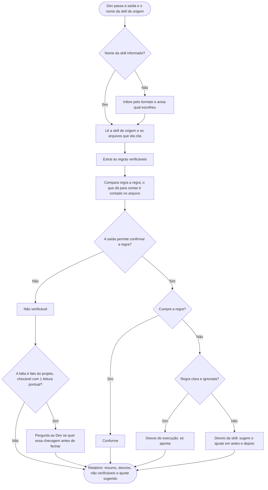

# Conferir saída

A skill `conferir-saida` verifica se o resultado de um teste de outra skill cumpre o que essa skill pede. A versão que o Claude lê é [../../skills/conferir-saida/SKILL.md](../../skills/conferir-saida/SKILL.md), telegráfica de propósito. As duas dizem a mesma coisa.

## Como pedir
Rodou uma skill (por exemplo, a `gerir-contexto`) e o arquivo gerado parece fora do combinado? O pedido traz o texto ou o caminho do arquivo e a skill que o gerou: "confere essa saída da gerir-contexto". Sem essa indicação, ela deduz pelo formato e avisa qual escolheu.

## O que acontece
1. **Ela lê a skill de origem** (e os arquivos que ela cita, como um template), não o projeto.
2. **Extrai as regras que dá para verificar:** seções e ordem, limites, proibições, estilo (por exemplo, sem "você" no texto), efeitos esperados (arquivo criado, `.gitignore`) e o que não devia acontecer (editar, commitar, perguntar).
3. **Compara regra por regra.** O que dá para contar, ela conta no arquivo. O que a saída não permite confirmar vira "não verificável", nunca "conforme por suposição".
4. **Classifica cada desvio:** erro de execução (a regra estava clara e foi ignorada) ou problema da skill (regra ambígua, faltando ou contraditória).

## O que sai
- **Resumo:** quantas regras, quantas conformes, desvios e não verificáveis.
- **Desvios:** a regra (com a linha do SKILL.md), o trecho da saída e a causa.
- **Não verificável:** a regra e o que faltou para confirmar.
- **Ajuste sugerido:** só para problemas da skill, a correção em blocos de antes e depois. Ela nunca altera a skill; aplicar é um pedido à parte do Dev.

## Limite
Ela compara apenas com a skill. A qualidade do conteúdo do projeto fica de fora.

## Fluxograma
Comportamento da skill, do pedido ao relatório.

## Por que é assim
- **Compara só com a skill.** O que se testa é se a skill foi seguida, não o projeto. É a ideia do teste de conformidade (*conformance testing*): a saída contra a especificação, e só ela. Por isso o desvio é classificado em erro de execução ou problema da skill.
- **"Não verificável" em vez de "conforme por suposição".** Um teste que passa sem provar nada engana. É o mesmo cuidado que a `revisar-qualidade` tem com teste que não consegue falhar.
- **Nunca altera a skill.** Ela só sugere o ajuste; aplicar é decisão do Dev, e a `mostrar-previa` só mostra como ficaria.
