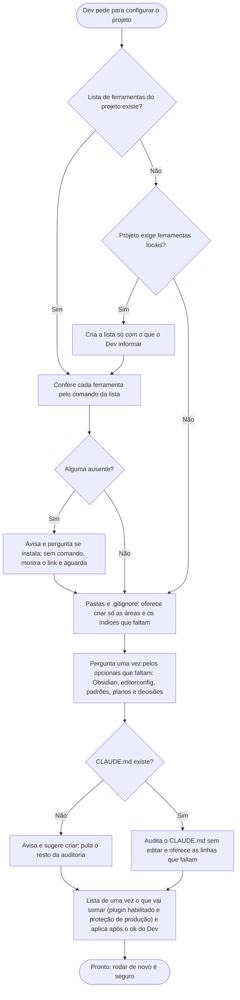

# Configurar projeto

A skill `configurar-projeto` prepara um projeto para usar o plugin. A versão que o Claude lê é [../../skills/configurar-projeto/SKILL.md](../../skills/configurar-projeto/SKILL.md), telegráfica de propósito. Obsidian e `.editorconfig` são opcionais e ficam em arquivos à parte, lidos só quando o Dev aceita: [OBSIDIAN.md](../../skills/configurar-projeto/OBSIDIAN.md) e [EDITORCONFIG.md](../../skills/configurar-projeto/EDITORCONFIG.md).

## Quando usar
No início de um projeto, ou ao preparar o Obsidian ou o `.editorconfig`. Exemplos de pedido: "configura este projeto", "prepara o Obsidian aqui".

## O que ela faz, em ordem
1. **Confere as ferramentas do projeto:** a lista fica no arquivo `ferramentas.md` da área de padrões (sugestão `docs/padroes/regras/ferramentas.md`), com uma linha por ferramenta, o comando para conferir e o comando ou link para instalar. O plugin não traz ferramenta nenhuma. Se faltar alguma, pergunta antes de instalar; sem comando, mostra o link ou a instrução e aguarda a confirmação. Sem lista, pergunta se o projeto exige ferramentas locais (exemplos: servidor de linguagem, CLI de build) e, se exigir, cria o arquivo só com o que for informado.
2. **Cria as pastas de documentação** (a raiz e a das especificações, onde ficam as regras de negócio), perguntando o nome de cada uma e sugerindo `docs/` e `docs/especificacoes/`; se o projeto já tem pastas com outros nomes, usa esses. Põe a pasta de sessões (plano de documentação e notas de trabalho, sugestão `docs/sessoes/`) no `.gitignore`, se faltar. Se faltar alguma área ou índice da árvore de `docs/` (ver [ORGANIZACAO.md](ORGANIZACAO.md)), oferece criar, menos planos e decisões, que são opcionais do passo 3; nunca move, renomeia nem apaga.
3. **Pergunta pelos opcionais que faltam**, numa pergunta só:
   - **Obsidian** (se não houver `docs/.obsidian/`): instala o app se precisar, ignora `docs/.obsidian/` no git e, com o cofre já aberto, sincroniza a configuração: o grafo e a busca ignoram as mesmas pastas do `.gitignore` (só acrescenta, nunca apaga o que foi posto à mão) e os Wikilinks são desligados. No final avisa para fechar e reabrir o Obsidian. Abrir `docs/` como cofre só o app faz. Se o cofre já existe, ela sincroniza sem perguntar.
   - **`.editorconfig`** (projeto sem o arquivo): cria com a formatação do projeto, para o código gerado sair igual. Só fixa o que o código já segue (indentação, quebra de linha antes de chaves, nomenclatura de campos, entre outros) e nunca fixa `charset` nem `end_of_line`. Quando a ferramenta de estilo só acusa regra no build com uma opção ligada, avisa e pergunta se cria a configuração. Antes de subir severidade, faz um build com a opção ligada e lista o que o arquivo acusa, sem corrigir.
   - **Padrões do projeto** (se faltarem): cria vazios os arquivos de práticas adotadas, de convenções da linguagem e, se o projeto tem testes, de testes (por exemplo `docs/padroes/regras/` com `praticas.md`, `convencoes.md` e `testes.md`; pastas e nomes são do projeto), cada grupo com um índice que lista os arquivos. Só as tags, o título e uma linha-guia: o conteúdo é do projeto, e é o que as skills passam a cobrar. Item sem marca é obrigatório; com `(preferível)` no fim, só recomendado. Opcionalmente o item segue `regra — como verificar`, para a revisão conferir por busca.
   - **Planos** (se o projeto ainda não tem a área de planos): cria a área, só com o índice. O arquivo de cada plano nasce na skill `criar-plano`. Ver [CRIAR-PLANO.md](CRIAR-PLANO.md).
   - **Decisões** (se o projeto ainda não tem a área de decisões): cria a área, só com o índice. Ver [DECISOES.md](DECISOES.md).
   - Se o Dev recusar, ela segue sem insistir.
4. **Audita o `CLAUDE.md`** (peso, regras repetidas e conteúdo de uso raro ou de um só módulo) sem editar. Se faltar a regra de commit, oferece "commit só quando pedido e só no repo da conversa, nunca em outro"; se faltar o ponteiro da skill, oferece "executar tarefa → usar a skill `executar-tarefa`". Se faltar a linha de pontos em aberto e exceções aceitas, oferece "achado de desvio do padrão fora do escopo da tarefa: propor registrar nos pontos em aberto; ao tocar um módulo, ler só as exceções aceitas dele" (ver [PONTOS-EM-ABERTO.md](PONTOS-EM-ABERTO.md) e [EXCECOES-ACEITAS.md](EXCECOES-ACEITAS.md)). Só adiciona o que o Dev aceitar. Sem `CLAUDE.md`, avisa e sugere criar, e segue para o passo 5.
5. **Habilita o plugin no projeto** (`enabledPlugins` em `.claude/settings.json`). Lista de uma vez tudo o que vai somar neste passo (settings e `CLAUDE.md`) e só aplica depois do ok do Dev. A permissão das skills não vai para o projeto: é preferência do Dev. Para não haver pergunta a cada skill, `Skill(arquitetura-e-qualidade:*)` entra em `permissions.allow` do `settings.json` global; a skill avisa e nunca mexe nele.
   - **Proteção do ambiente de produção:** soma em `permissions.ask` do projeto regras que fazem o Claude pedir aprovação do Dev antes de qualquer comando que cite o ambiente de produção (o nome é o do projeto; sugestão `Production`), e acrescenta ao `CLAUDE.md` a regra de nunca usar produção nem como contorno de bloqueio sem perguntar. É `ask` e não `deny`, para o Dev poder aprovar. Nada é duplicado.

## Rodar de novo
É seguro repetir: o que já está feito não muda, e a sincronização do cofre só acrescenta o que faltar.

## Regras
- Não altera código.
- Não remove nada configurado manualmente.

## Fluxograma
Comportamento da skill, na ordem fixa dos passos.

## Por que é assim
- **Ordem fixa e seguro repetir.** Configuração que se pode rodar de novo sem estragar o que já está feito é a ideia de idempotência, comum em scripts de preparação de ambiente. Por isso cada passo confere o que existe antes de criar.
- **`CLAUDE.md` curto e constante.** Ele é lido em toda sessão, então só leva o que vale sempre. O que é de um módulo vai para a documentação, especificação ou decisão dele, lidas só ao tocar o módulo; o que é de uma tarefa fica na própria tarefa e sai do caminho ao concluir. É a divulgação progressiva (*progressive disclosure*): o essencial na frente, o detalhe só quando faz falta.
