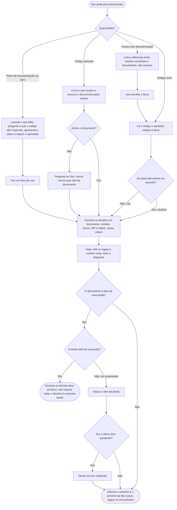

# Criar documentação

A skill `criar-documentacao` cria e atualiza a documentação do projeto a partir do código. A versão que o Claude lê é [../../skills/criar-documentacao/SKILL.md](../../skills/criar-documentacao/SKILL.md), telegráfica de propósito. As duas dizem a mesma coisa.

## Um documento por vez
Cada rodada produz **um** documento. Ao terminar, ela diz só o nome e o caminho do que criou e qual é o próximo, e para. O Dev diz "próximo" para continuar. A exceção é quando a `executar-tarefa` a chama durante uma tarefa: aí ela escreve todos os documentos do bloco Documentação, cada um conferido, e devolve o controle para o build.

## Como pedir
- **Depois de criar código novo:** "documenta o que foi feito". Ela usa os arquivos alterados na sessão.
- **Sistema que já existe:** só quando o Dev pede, e por escopo: "documenta o fluxo de pedidos". Ela nunca varre o projeto inteiro. Se o escopo não estiver claro, pergunta.
- **Fluxos sem documentação:** "verifica fluxos sem documentação". Ela compara as tags de fluxo das tarefas concluídas com as dos documentos e lista o que falta (fluxo, módulo e tarefa de origem), sem escrever nada. O Dev escolhe qual documentar. Fluxo sem arquivo de tarefa concluída não aparece; para esse, vale o plano de documentação.
- **Depois de alterar código que já tem documentação** (só quando o Dev pede): ela atualiza o que ficou desatualizado. Como os documentos não citam arquivos de código, ela acha o documento afetado pelos nomes (módulo, rota, etapa, mensagem de erro, configuração). Se não achar nenhum, pergunta ao Dev em vez de concluir que não existe. Refatoração que não muda nada observável não gera edição.
- **Plano de documentação:** "monta o plano de documentação do módulo Vendas".
- **Um item do plano de documentação:** "faz o item 3".

## O que sai
Documentação para quem usa o sistema: o **negócio** e o **dev que integra** a API. Linguagem de negócio, sem links nem caminhos para o código e sem termos de camada (Domínio, Aplicação, Infraestrutura). Um arquivo por assunto, sem versão separada para a IA:

- **Visão geral** (índice da pasta): uma frase sobre o que a pasta guarda e a lista de módulos em ordem alfabética, cada um com link e uma linha de descrição (a mesma nas tarefas e nas especificações), mais o que ainda não está documentado. Ela só aponta, sem repetir o conteúdo dos outros documentos. Os fluxos e a API não aparecem direto nela: cada módulo já linka os seus.
- **Módulo** (`docs/documentacao/modulos/<nome>/<nome>.md`, na pasta do módulo, com a API em `api/` e os fluxos em `fluxos/`): um link de volta à visão geral no topo, depois o que o módulo é, as etapas, as regras em linguagem de negócio e links para os fluxos e para a API.
- **Integração** (`docs/documentacao/modulos/<nome>/api/<nome>-api.md`): guia para quem consome a API. Aponta para a especificação de API publicada pelo projeto (OpenAPI/Swagger ou equivalente), que já traz o contrato exato de cada rota, e explica só o que ele não diz: a ordem das chamadas (tabela de passos, com o que foge da sequência, como cancelar, em destaque) e as respostas e erros (tabela de status). Se o projeto não publica esse contrato, ela pergunta se o contrato deve ir por escrito.
- **Fluxos** (`docs/documentacao/modulos/<nome>/fluxos/<fluxo>.md`): um por fluxo, com objetivo, diagrama(s) e regras. Fluxo que toca mais de um módulo fica na pasta do módulo principal (o primeiro citado), e os outros módulos o linkam.
- **Técnico por projeto** (Domínio, Aplicação...): não faz parte do padrão. Só se o Dev pedir, em `docs/documentacao/modulos/<nome>/<nome>-<projeto>.md`.

O diagrama segue o formato do projeto; sem padrão, a sugestão é Mermaid, uma sintaxe de texto que vira diagrama no GitHub, no Obsidian e no VS Code, sempre na vertical (de cima para baixo), que fica legível em qualquer largura de tela. O fluxograma serve à lógica de decisão e aos passos de um ator; o diagrama de sequência, à interação entre módulos ou atores (mensagens, eventos, ordem das chamadas). Fluxo com os dois aspectos pode ter os dois. Convenções e formatos (por cenário e completo) em [CRIAR-DIAGRAMA.md](CRIAR-DIAGRAMA.md) e em `docs/instrucoes/DIAGRAMAS.md`; o padrão do projeto nunca é sobreposto.

**Estilo dos documentos** (quando o projeto não tem padrão próprio): títulos com iniciais maiúsculas, sequências e respostas em tabela (status e passos em negrito, detalhes em itálico) e exceções à regra geral em um destaque de atenção. Os fluxos mantêm o diagrama.

**Tags:** todo documento leva uma linha `tags:` no topo: `documentacao` mais as tags de assunto: `modulo/` em todas (menos a visão geral), `fluxo/` no fluxo e `camada/` na API e nas docs de camada. Os nomes só usam módulos, fluxos e camadas que existem; tag sem correspondente é proposta ao Dev antes. Doc não tem estado e nunca cita tarefas. Ver [TAGS.md](TAGS.md).

Se o projeto já tem um padrão de documentação, ela segue o padrão dele.

## Código novo: o que acontece
1. Ela lê o código que mudou, identifica o fluxo e o módulo tocados e procura se já existe documento deles. Se existir, atualiza; se não, cria.
2. Ela escreve os documentos nesta ordem: módulo, fluxos, API (se houver rotas) e, por último, a visão geral, que ganha só o link do módulo, na ordem alfabética, com a descrição dele. Cada documento é conferido antes de entregar; link para um documento que ainda está na fila vale, e no fim ela confere todos os links.
3. Depois do último, ela para. O que ficou de fora aparece na visão geral como "não documentado". O plano de documentação do restante pode ser pedido (ver "O plano de documentação").

## Documentação de uma tarefa
Se a tarefa está em execução (a skill foi chamada pela `executar-tarefa`), ela não marca nada: a `executar-tarefa` marca os itens e troca a tag depois do build. Se a tarefa está em andamento, ela marca `[x]` no item do documento escrito e, se esse era o último item pendente, troca a tag para `tarefa/em-validacao`: a conclusão vem com o "aprovado" do Dev, pela `executar-tarefa`. A tarefa vem do que for informado ou da única tarefa do módulo em execução ou em andamento; havendo mais de uma, ela pergunta. Sem tarefa ligada, nada muda.

## O plano de documentação
Segue o mesmo rito da skill `criar-plano` (perguntas e "aprovado"), mas é outro arquivo, de trabalho:
1. Ela levanta o que falta (só nomes, sem ler tudo) e pergunta o que o código não responde, como o que entra, o que é legado e a prioridade.
2. Ela apresenta o plano sem criar nada. Cada item é exatamente **um documento**, com o destino, o código que ele cobre e as dependências, em ordem. Termina com "Aguardando aprovação."
3. A aprovação vem com um "aprovado" claro. Se houver pedido de ajustes, ela revisa e mostra de novo.
4. Aprovado, o plano é salvo em `docs/sessoes/plano-documentacao.md`, como uma checklist, e ela faz o **item 1**. Essa pasta fica fora do git (ela a acrescenta ao `.gitignore` se faltar), porque o plano é uma ferramenta de trabalho e não faz parte da documentação para o cliente. A retomada vale em qualquer sessão, na mesma máquina. Para passar a outro dev, envia-se o arquivo.
5. Os demais itens saem **um por vez**, quando o Dev diz "próximo" ou "faz o item N". Ao terminar, ela marca o item e diz qual é o próximo. Nunca faz um item que não foi pedido.

## Regras
- **Só fatos:** tudo vem do código lido ou do Dev, mas o documento não cita arquivo. Rotas e mensagens de erro são copiadas exatas do código. O que não foi confirmado não é escrito: ela pergunta ao Dev.
- **Só o que está no git:** ela não cita arquivos ou pastas que o git ignora (por exemplo uma pasta `runbooks/` listada no `.gitignore`). Ela confere isso antes de entregar.
- **Um fato, um lugar:** os demais documentos apontam por link.
- **Cada documento linka de volta ao pai:** o fluxo e a API apontam para o módulo, e o módulo aponta para a visão geral. Só a visão geral não tem para onde voltar. Um documento técnico aponta para o módulo, mas o módulo nunca lista o técnico de volta, porque ele fica fora do padrão.
- **Nomes no idioma do projeto**, em arquivos, pastas e títulos; sem padrão, ela pergunta. Sem regra do projeto, os documentos de um módulo levam o nome do módulo na frente (`pedidos-api.md`), porque o grafo e a busca do Obsidian mostram só o nome do arquivo e vários `api.md` seriam indistinguíveis. A exceção é a nota do módulo (`pedidos.md`), que repete o nome nas tarefas e na documentação. A visão geral leva o nome da pasta (ex.: `documentacao.md`), como o índice das tarefas e o das especificações.
- **Não altera código e não faz commit.**
- **Prévia:** para ver a mudança de um documento existente antes de aplicar, vale pedir a prévia (antes e depois).

## Especificação
A especificação aprovada ([CRIAR-ESPECIFICACAO.md](CRIAR-ESPECIFICACAO.md)) orienta o que documentar, mas a documentação só registra o que o código confirma e nunca cita a especificação.

## Fluxograma
Comportamento da skill por tipo de pedido, até a entrega de um documento.

## Por que é assim
- **Documentação como código (*docs as code*).** Texto em Markdown, versionado no git, com diagramas em formato de texto (por exemplo, Mermaid). Assim a documentação é revisada, comparada e atualizada como o código, e o Claude consegue editá-la.
- **Fluxograma e diagrama de sequência (UML) coexistem.** Cada um responde uma pergunta: a decisão e os passos de um ator, ou a ordem das mensagens entre atores.
- **Um fato, um lugar.** É o DRY aplicado à documentação.
- **Linguagem de negócio, sem caminhos para o código.** A documentação descreve o negócio e os fluxos do sistema (o que ele oferece e como se usa), o que serve a qualquer leitor, inclusive o dev que quer entender o fluxo rápido. Caminhos e links para código quebram a cada refatoração e deixariam o documento desatualizado sem que o fluxo tivesse mudado.
- **Um documento por vez.** Cada um é conferido antes de entregar, e o Dev decide o ritmo.
- **Só o que está no git.** Quem clonar o projeto precisa encontrar tudo o que a documentação cita.
