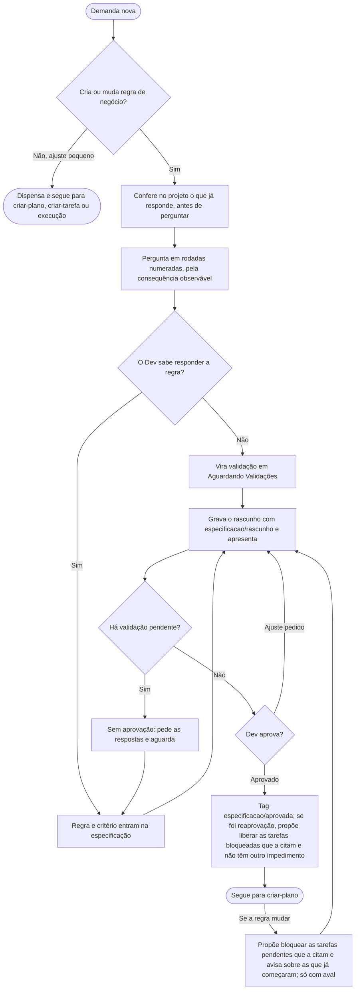

# Criar especificação

A skill `criar-especificacao` decide e registra as regras de negócio **antes** do plano, para o projeto não perder a essência do que foi combinado. A versão que o Claude lê é [../../skills/criar-especificacao/SKILL.md](../../skills/criar-especificacao/SKILL.md), telegráfica de propósito. As duas dizem a mesma coisa.

## Onde entra
`criar-especificacao` → `criar-plano` → `criar-tarefa` → `executar-tarefa`. A especificação diz **o quê** e como saber que está certo. O plano e as tarefas dizem **como**. A documentação, no fim, descreve o que foi implementado.

## Quando não é preciso
Ajuste pequeno que não cria nem muda regra de negócio (texto, configuração, refatoração, correção pequena) vai direto para o plano, para o arquivo da tarefa ou para a execução do ajuste. Na dúvida, o Claude pergunta. A especificação pode ser pedida mesmo assim.

## Como pedir
O pedido indica o módulo e o fluxo: "especifica o cancelamento de pedido". Havendo regras já escritas, o Claude as organiza e pergunta só o que faltar. Sem elas, conduz por perguntas.

## O que acontece
1. Ele confere o que o projeto já responde (docs do assunto) antes de perguntar. Termo de negócio que diverge do usado no projeto para o mesmo conceito é confirmado na mesma rodada.
2. Pergunta as regras em rodadas curtas e numeradas, pela consequência que o Dev veria ("o pedido aceito ainda pode ser cancelado?"). Resposta vaga gera nova pergunta; ele nunca preenche por conta própria. Regra que o Dev ainda não sabe responder não é escrita: vira uma **validação** na seção `Aguardando Validações` (pergunta + o que acontece hoje), e o resto segue.
3. Grava um **rascunho** e pede aprovação. Só "aprovado" vira **aprovada**. Com validação pendente não há aprovação: quando o Dev responde, a regra e o critério entram na especificação e a validação sai.
4. As tarefas e a execução usam a especificação aprovada. Quando todas as tarefas que a citam estão concluídas, ela vira **implementada**. Uma tarefa nova que a cite (por exemplo, a correção de um defeito) a devolve a aprovada até concluir.

## O que sai
Pasta `docs/especificacoes/`, com a mesma divisão da documentação e das tarefas:
- `<pasta>.md`: visão geral no mesmo modelo da documentação e das tarefas: uma frase sobre a pasta e a lista de módulos em ordem alfabética, com link e descrição.
- `modulos/<módulo>/<módulo>.md`: regras de negócio do módulo (a essência).
- `modulos/<módulo>/fluxos/<módulo>-<fluxo>.md`: regras do fluxo e **critérios de aceite**.

Um critério de aceite é uma condição concreta que diz como saber se o fluxo está certo, em tabela `Critério | Quando | Então`. O número (`Critério 1: cancelar antes do aceite`) é fixo: a tarefa diz qual critério cada item cumpre, e a revisão confere cada um contra o código.

A escrita é para o Dev e para a IA entenderem na primeira leitura: títulos sempre iguais, frases curtas, uma regra por linha, cada regra com um nome que diz o que ela é. Só o quê, nunca o como.

## Se a regra mudar
O Claude edita, volta a especificação para rascunho e pede nova aprovação. Propõe bloquear as tarefas pendentes que a citam e avisa sobre as que já começaram (o Dev decide o que fazer com elas). Na nova aprovação, propõe liberar as tarefas bloqueadas que a citam e não têm outro impedimento (outra dependência ou linha `**Bloqueio:**`). Só troca a tag das tarefas com o aval do Dev. Se o critério que mudou já foi cumprido por uma tarefa concluída, ela lista essa tarefa e propõe uma nova, que aponta para a original.

## Obsoleta ou apagada
Só quando o Dev diz, a especificação vira **obsoleta** (substituída ou abandonada), a partir de qualquer estado (inclusive rascunho), com uma linha no topo: data, motivo e, se houver, link para a substituta. Só é apagada, com aceite, se nenhuma nota a cita; a linha do índice sai junto.

## O que ela não faz
- Não altera código. Nas tarefas, só troca a tag de estado, e com o aval do Dev.
- Não decide regra de negócio pelo Dev.

## Fluxograma
Comportamento da skill, da demanda à especificação aprovada.

## Por que é assim
- **É uma versão de desenvolvimento orientado por especificações (*spec-driven development*, SDD).** Nesse método, a especificação detalhada se torna a fonte da verdade das regras de negócio antes de qualquer linha de código ser escrita. Em vez do chamado *vibe coding* (jogar pedidos soltos para a IA e consertar o código depois), o processo é estruturado para guiar a IA de forma previsível e com menos retrabalho: aqui, a sequência é especificar, planejar, criar a tarefa e executar. A especificação pode mudar no meio do caminho, mas a mudança é explícita (ver "Se a regra mudar").
- **Obsoleta em vez de apagada.** Quem lê depois entende por que o comportamento mudou, e os links das tarefas continuam valendo. Sem nenhuma nota citando, apagar não perde nada: o git guarda o arquivo.
- **Critérios concretos em `Quando` e `Então`.** É uma versão curta dos cenários *Dado/Quando/Então* do BDD (Dan North) e da ideia de especificar por exemplos concretos (*Specification by Example*, de Gojko Adzic): uma condição observável, não uma frase vaga.
- **Só o quê, nunca o como.** Separa a regra de negócio da implementação: a regra sobrevive à troca de tecnologia, e o plano e as tarefas cuidam do como.
- **Perguntas pela consequência que o Dev veria.** A resposta vem pelo que se observaria no sistema, não em termos de código, e a regra sai com o sentido pretendido.
- **Dúvida vira validação, não regra.** Regra que ninguém sabe responder, se escrita, vira suposição com cara de fato. Por isso fica pendente até alguém responder.
- **Aprovação explícita.** Só "aprovado" muda o estado, para o plano partir de uma regra que o Dev realmente confirmou.
