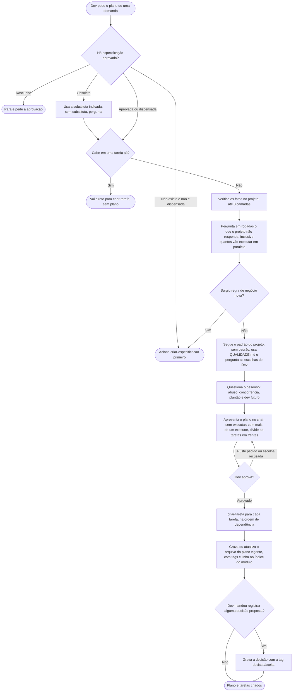

# Criar plano

A skill `criar-plano` transforma uma demanda em um plano aprovado pelo Dev e, só depois, em tarefas. A versão que o Claude lê é [../../skills/criar-plano/SKILL.md](../../skills/criar-plano/SKILL.md), telegráfica de propósito. As duas dizem a mesma coisa.

## Antes do plano: a especificação
Toda demanda nova começa por [criar-especificacao](CRIAR-ESPECIFICACAO.md), que decide e registra as regras de negócio. O plano parte da especificação aprovada e cuida só do "como". Ajuste pequeno, que não muda regra de negócio, dispensa a especificação. Se a especificação do assunto estiver obsoleta, ela usa a substituta indicada nela; sem substituta, pergunta. Se uma regra de negócio nova surgir durante o planejamento, a skill para e volta para a especificação.

## Como pedir
O pedido descreve a demanda e traz o que já houver: objetivo, o que entra e o que não entra, restrições, critérios de aceite e links ou documentos. Quanto mais dados no começo, menos perguntas ela faz. Com a especificação resolvida (aprovada ou dispensada), se a demanda cabe em uma única tarefa, ela dispensa o plano e vai direto para a criação da tarefa.

## O que acontece
1. **Ela lê o que foi citado** e verifica no projeto o que dá para confirmar sozinha, antes de perguntar. Fato ela descobre lendo e cita a fonte. Decisão (regra, escopo, prioridade) é do Dev, e ela nunca decide por ele.
2. **Ela pergunta** o que o projeto não responde. As perguntas vêm em rodadas, numeradas, formuladas pela consequência que o Dev observaria (por exemplo, "o lote esgotado some da vitrine ou continua riscado?") e não em termos de código. Cada uma diz o que já foi verificado e por que a resposta importa. Se a resposta for vaga, ela pergunta de novo, sem preencher a lacuna por conta própria. Ela sempre pergunta quantas pessoas ou agentes vão executar o plano em paralelo.
3. **Ela testa o desenho sob quatro ângulos** antes de fechá-lo: como alguém abusaria disso, o que acontece se dois usuários fizerem a mesma coisa no mesmo segundo, se o suporte consegue diagnosticar e desfazer sem programador e onde a solução cobra caro no futuro. Cada ângulo vira uma pergunta ou uma verificação no código, nunca um risco inventado.
4. **Ela apresenta o plano** em texto curto, sem explicar a metodologia (só os componentes) e sem fazer nenhuma alteração. O plano termina com "Aguardando aprovação." e, se houver decisão proposta, pergunta se cada uma deve ser registrada.
5. **O Dev aprova** dizendo claramente "aprovado" (ou algo equivalente). Se pedir ajustes, ela revisa e mostra de novo. Silêncio ou dúvida não contam como aprovação. Se o "aprovado" não disser nada sobre as decisões propostas, ela pergunta uma vez antes de gravá-las.
6. **Ela gera as tarefas**, uma por item do plano, na ordem de dependência, usando a skill de criar tarefa, e grava o arquivo do plano (ver abaixo). Se a demanda já tem plano vigente, ele é atualizado.

## O arquivo do plano
Depois do "aprovado", o plano vira um arquivo, na área de planos do projeto (sugestão `docs/planos/modulos/<modulo>/<demanda>.md`; ver [ORGANIZACAO.md](ORGANIZACAO.md)), com tags e linha no índice. Demanda em mais de um módulo fica no módulo principal e leva as tags de todos. A estrutura vem do modelo do projeto; sem modelo, vale o exemplo do plugin.
- **Funcionalidades, tarefas e pendências** levam `[ ]`. A tarefa é marcada `[x]` pelo `executar-tarefa` quando é concluída, com o "aprovado" do Dev (em validação, ainda não). A funcionalidade é marcada quando todas as suas tarefas estão concluídas. A pendência só é marcada quando o Dev confirma que foi resolvida, e a resposta fica anotada na mesma linha. Não há marcação intermediária (em execução, em andamento): isso fica na tag da tarefa.
- **Estado:** o plano nasce `vigente`. Só quando o Dev diz, vira `obsoleto` (substituído ou abandonado), com uma linha no topo (data, motivo e, se houver, link para o substituto). Se o módulo tem vários planos vigentes, o da demanda é achado pelo título; na dúvida, a skill pergunta. Só é apagado, com aceite, se nenhuma nota o cita.
- **Pendência nova** que surge na execução é proposta ao Dev e só é gravada com o aceite.
- **Diagrama** só entra quando o fluxo tem mais de um passo ou ator.
- **Fatos e impacto por divisão** ficam só no plano apresentado no chat: são o que foi verificado e não precisam de status.
- As tarefas continuam na pasta de tarefas; o plano só aponta para elas.

## O que tem no plano
- **Objetivo:** uma linha.
- **Funcionalidades:** o que a demanda entrega, com os critérios que cada uma cobre.
- **Fluxo:** entrada, processamento, saída e eventos gerados.
- **Especificação:** o arquivo e os critérios de aceite que o plano cobre.
- **Fatos:** cada um com a fonte, que é um arquivo e linha ou "usuário".
- **Impacto por divisão:** só as divisões da arquitetura do projeto (camada, módulo, pasta), verificadas no código, com os componentes a criar ou alterar.
- **Decisões:** o que será feito e por quê, com marca nas que dependem da confirmação do Dev.
- **Decisões estruturais:** em projeto que adotou [decisões](DECISOES.md), a escolha difícil de reverter vem marcada `decisão proposta`, e o Dev diz se cada uma deve ser registrada. Registrada, ela nasce já `aceita`, junto com as tarefas. Se o Dev recusar a escolha, o plano é ajustado; se recusar só o registro, a escolha fica apenas na seção Decisões do plano. As decisões aceitas do módulo são lidas antes e mandam sobre o plano.
- **Alternativas descartadas:** uma linha por alternativa, com o motivo. Quando o caminho parece barato mas cobra caro depois, vem marcado com `ARMADILHA:`.
- **Padrão seguido:** o arquivo do projeto usado como referência, ou "nenhum".
- **Tarefas:** título, camadas, dependências e critério de pronto observável (build, teste ou fluxo), em ordem de execução. Uma tarefa que depende de algo externo, como uma credencial ou a resposta de um terceiro, vem marcada como `BLOQUEADO`, com o que a destrava; ela já nasce bloqueada e só o Dev a libera.
- **Frentes:** só quando mais de uma pessoa ou agente vai executar em paralelo. Cada frente tem nome genérico (`Frente A`, `Frente B`...) e as tarefas na ordem sugerida, sem responsável. Tarefas em cadeia de dependência ficam na mesma frente; tarefas que mexem no mesmo arquivo ficam na mesma frente ou ganham dependência entre si, e essa dependência pode ligar frentes diferentes; o resto equilibra as frentes. Se uma frente ficar vazia, a skill avisa que o paralelo não ajuda. O bloqueio entre frentes usa as Dependências das tarefas.
- **Pendências:** o que ainda não é fato. Suposição não entra no plano, e um risco só aparece se estiver comprovado no código ou tiver sido informado pelo Dev.

## Regras
- **Só fatos:** tudo o que o plano afirma vem do código, dos documentos ou do Dev.
- **Padrão do projeto primeiro:** ela segue o que já existe. Se não houver padrão, usa as regras de qualidade do plugin e avisa.
- **Nada é alterado antes da aprovação.** Depois dela, além das tarefas, só o arquivo do plano e as decisões que o Dev mandou registrar.
- **Linguagem do domínio:** se a demanda usa um termo de negócio diferente do que a documentação e a especificação já usam para o mesmo conceito, o Claude confirma antes, com uma pergunta na mesma rodada. Confirmado como sinônimo, a equivalência pode ser gravada numa linha na especificação do módulo, com aceite.

## Fluxograma
Comportamento da skill, do pedido às tarefas e ao arquivo do plano.

## Por que é assim
- **Plano aprovado antes de qualquer alteração.** Errar o desenho num texto custa muito menos que refazer código. Por isso nada é criado antes do "aprovado" do Dev.
- **Alternativas descartadas com o motivo.** É o campo **Descartado** da [decisão](DECISOES.md) (o ADR de Nygard): evita que alguém reabra uma discussão sem lembrar por que a opção foi rejeitada.
- **Plano em arquivo, com `[ ]` e só depois da aprovação.** O plano que só existe no chat se perde ao trocar de sessão; o arquivo guarda o que foi decidido e o que falta. O `[ ]` é a lista de tarefas pendentes (*checklist*) do Markdown, o mesmo formato das tarefas.
- **Critério de pronto observável em cada tarefa.** Segue a ideia da definição de pronto (*Definition of Done*): build, teste ou fluxo que se possa ver, não "está pronto" por opinião.
- **Frentes com nome genérico e sem responsável.** No planejamento, quase nunca se sabe quem vai executar; o plano diz só o que pode andar em paralelo. Tarefas que mexem no mesmo arquivo ficam na mesma frente para evitar conflito na hora do merge.
- **Os quatro ângulos.** São perguntas que o desenho normal costuma esconder (abuso, concorrência, suporte e custo futuro), por isso cada uma vira pergunta ou verificação no código, nunca um risco inventado.
