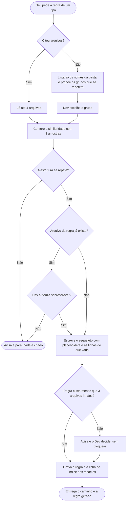

# Criar regra telegráfica

Quando o projeto tem muitos arquivos do mesmo tipo (entidades, commands, handlers), o Claude hoje lê um deles inteiro só para copiar o padrão. A skill `criar-regra-telegrafica` resume esse padrão em poucas linhas, que o Claude lê no lugar do arquivo. A versão que o Claude lê é [../../skills/criar-regra-telegrafica/SKILL.md](../../skills/criar-regra-telegrafica/SKILL.md), telegráfica de propósito.

## Como pedir
- **Com arquivos:** "cria a regra de entidade a partir de Usuario.cs e Pedido.cs".
- **Sem arquivo:** "cria uma regra telegráfica no módulo Autenticação". Ela lista só os nomes dos arquivos do módulo, mostra os grupos que se repetem (por exemplo, 6 entidades) e o Dev escolhe qual vira regra.

## O que sai
Um arquivo `docs/padroes/modelos/<tipo>.md` com as tags no topo e duas partes: o título e um **esqueleto quase completo em código real da linguagem do projeto**, com a formatação exata, e abaixo 3 a 5 linhas curtas sobre o que costuma variar. Tudo o que muda entre os arquivos do tipo (verbo, rota, parâmetros, status de sucesso e de erro, exceções, retorno) vira placeholder; fica no código só a estrutura. Havendo vários `catch`, o esqueleto mostra um e o texto descreve os demais. O texto não cita arquivos reais nem regras de produto ou segurança (autorização, perfis), que são do plano e da tarefa.

Para separar o padrão das manias de um arquivo isolado, ela lê vários irmãos e usa o mais limpo como molde. Se os irmãos divergirem entre si, vale a maioria e ela avisa o Dev dos desvios, sem registrá-los. Se o mesmo bloco se repete em todos, ela avisa que pode virar código compartilhado, sem mexer no código.

Antes de gravar, compara os tokens aproximados da regra com os de 3 arquivos irmãos. Menor: grava. Maior: avisa e o Dev decide. Se o arquivo da regra já existe, ela pergunta antes de sobrescrever. Gravada a regra, acrescenta uma linha para ela no índice da pasta de modelos (e cria o índice se faltar).

## Como as outras skills usam
`criar-tarefa`, `criar-plano`, `criar-documentacao` e `revisar-qualidade` procuram em `docs/padroes/modelos/` uma regra do tipo antes de abrir um arquivo irmão. Havendo regra, leem só ela; não havendo, abrem até 3 irmãos.

A regra é um **modelo base**, não uma lei: se o alvo não se encaixa no esqueleto (outra interface, retorno ou forma de endpoint), a `executar-tarefa` pergunta ao Dev em vez de adaptar sozinha.

## O que ela não faz
- Não altera código nem faz commit.
- Não varre o projeto: com arquivos citados lê no máximo 4; sem arquivo, só lista nomes de um módulo.
- Não cria regra de estrutura que não se repete: avisa e para.

## Fluxograma
Comportamento da skill, do pedido à gravação da regra.

## Por que é assim
- **Resumir em vez de ler um arquivo inteiro.** Ler um arquivo só para copiar o padrão custa tokens e copia as manias dele. O esqueleto com placeholders funciona como um modelo (*template*): fica só a estrutura.
- **Vários irmãos, vale a maioria.** Um arquivo isolado mistura o padrão com o gosto de quem o escreveu; com vários, o que se repete é o padrão.
- **Modelo base, não lei.** O esqueleto cobre o que se repete; o alvo que foge dele é decisão do Dev.
- **Compara o custo antes de gravar.** A regra existe para economizar leitura.
