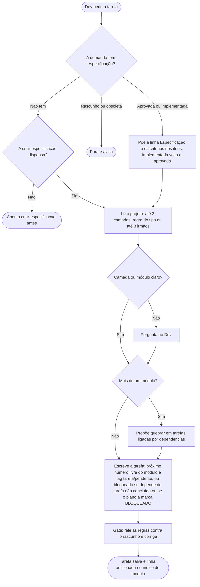

# Criar tarefa

A skill `criar-tarefa` gera uma tarefa em Markdown a partir de um pedido do Dev. A versão que o Claude lê é [../../skills/criar-tarefa/SKILL.md](../../skills/criar-tarefa/SKILL.md), telegráfica de propósito. As duas dizem a mesma coisa.

## Como pedir
O pedido descreve a tarefa em uma ou duas frases. Ex.: "criar tarefa para cadastro de Cliente no módulo Vendas".

## O que sai
Um arquivo `docs/tarefas/modulos/<modulo>/NN-<nome>.md`, com o próximo número livre na pasta do módulo, seguindo o [template](../../skills/criar-tarefa/TEMPLATE-TAREFA.md). A estrutura é sempre a do template — o `CLAUDE.md` do projeto não acrescenta seção nova à tarefa, mesmo pedindo algo diferente:

- **Título:** verbo no infinitivo mais o que a tarefa entrega, cobrindo todas as frentes. Deve servir como mensagem de commit.
- **Frontmatter:** `tags` (`tarefas` mais módulo, fluxo e camada dos documentos que a tarefa toca) e a tag de estado, que começa em `tarefa/pendente`. Começa em `tarefa/bloqueado` quando depende de tarefa ainda não concluída (é liberada sozinha quando a dependência é aprovada) ou quando o plano a marca como `BLOQUEADO` (com a linha `**Bloqueio:**` dizendo o que a destrava; só o Dev a libera). Ver [TAGS.md](TAGS.md).
- **Cabeçalho:** módulo, camada, dependências e, quando a demanda tem especificação aprovada, o link para ela. Os itens que cumprem um critério dela terminam com `(Critério N)`; a tarefa não repete as regras. Especificação já implementada (por exemplo, numa tarefa de defeito) é aceita e volta a aprovada até a tarefa concluir.
- **O que fazer:** as regras e decisões da tarefa que o checklist não deixa óbvias, em uma linha cada. Padrões de projeto aplicados são citados pelo nome.
- **Checklist:** o passo a passo, com um bloco para cada camada que a tarefa toca (por exemplo Domínio, Aplicação, Infraestrutura, API, DI & Migrations), em ordem de dependência. O bloco "Documentação" vem em penúltimo: um item para cada documento que a tarefa toca (fluxo, módulo). Tarefa sem código novo (só configuração ou texto) fica sem esse bloco. O bloco "QA & Testes" vem por último, quando o projeto usa testes. Os blocos são numerados em sequência e os itens usam só letras (`a:`, `b:`...), recomeçando em `a` a cada bloco.

## Como ela lê o projeto
Para não gastar tokens, o Claude consulta o código existente em no máximo 3 camadas, priorizando as que a tarefa cria. Se o projeto tem uma regra do tipo em `docs/padroes/modelos/` (ver [CRIAR-REGRA-TELEGRAFICA.md](CRIAR-REGRA-TELEGRAFICA.md)), ele lê só ela; senão compara com até 3 arquivos irmãos reais do mesmo tipo e camada (o mais recente, o mais parecido e um de outra unidade; sem maioria entre eles, ele pergunta). Ele avisa que lê só isso; o Dev pode pedir mais (vale só naquela vez). Se a camada ou o módulo não estiver claro, ele pergunta.

## O que se nota nos itens
- Cada item é uma ação direta: verbo, o quê e onde.
- Pasta com vários arquivos vira um item que termina em "com:", e cada arquivo é um sub-item (`b.1`, `b.2`...) sem repetir a pasta: o contexto vem do item pai, e cada sub-item pode ser executado sozinho. Nada de "Dentro dela" entre itens irmãos.
- Todo arquivo ou pasta diz onde fica. Projeto novo é um passo só ("Na pasta X/, criar o projeto Y"), porque a pasta do projeto já vem com ele; pastas que não vêm de graça (agrupadora do módulo, internas ao projeto) têm passo próprio.
- Objeto de dados sem comportamento (request, response, VO simples) já sai com a construção imutável da linguagem indicada no passo, em vez de esperar a revisão.
- Validações trazem critério concreto. Se faltar, o Claude pergunta em vez de inventar.
- Nomes de arquivos, classes, pastas e projetos seguem o idioma e a caixa do projeto (exceto tipos impostos por biblioteca); sem padrão, o Claude pergunta.
- Termos do domínio seguem os da documentação e da especificação do projeto.
- Passos mecânicos de convenção fixa (por exemplo, registrar na solution ou referenciar entre projetos) ficam de fora.

## Escopo
- **Escopo mínimo:** a tarefa cobre só o que foi pedido. Ideias extras vão como sugestão, fora da tarefa.
- **Tarefa grande demais:** com mais de um módulo, a skill propõe quebrar em tarefas ligadas por dependências.
- **Tarefa existente:** é editada direto, e o nome do arquivo não muda, porque outras tarefas e o plano apontam para ele. Apagar só em caso extremo, com aceite do Dev (ver [TAGS.md](TAGS.md)).
- **Prévia:** para ver como ficaria a alteração de uma tarefa existente antes de aplicar, vale pedir a prévia (antes e depois).
- **Índice das tarefas:** o índice geral (uma frase sobre a pasta e a lista de módulos em ordem alfabética, com link e descrição, igual ao da documentação e ao das especificações) só linka o índice de cada módulo (`docs/tarefas/modulos/<modulo>/<modulo>.md`); a linha da tarefa nova (link `<tarefa>.md`) é adicionada no índice do módulo, não no geral. Módulo sem regra de negócio nem fluxo (ex.: compartilhado) também entra na lista. Inconsistência numa linha existente é sinalizada, nunca corrigida sem pedido. O índice do módulo leva `tarefas` e `modulo/<m>`, sem estado.

## Fluxograma
Comportamento da skill, do pedido à tarefa salva.

## Por que é assim
- **Tarefa pequena e visível.** É a ideia do cartão do Kanban: uma unidade de trabalho que cabe numa olhada. Por isso a tarefa grande demais é quebrada em tarefas ligadas por dependências.
- **"QA & Testes" por último.** Faz o papel da definição de pronto (*Definition of Done*) do Scrum: em projeto com testes, toda tarefa termina com a mesma verificação.
- **Título que serve de mensagem de commit.** Assim a tarefa e o commit contam a mesma história.
- **Link para a especificação em vez de repetir as regras.** Um fato, um lugar (DRY): se a regra mudar, muda numa só.
- **Escopo mínimo.** É o YAGNI: só o que foi pedido entra; o resto vira sugestão.
