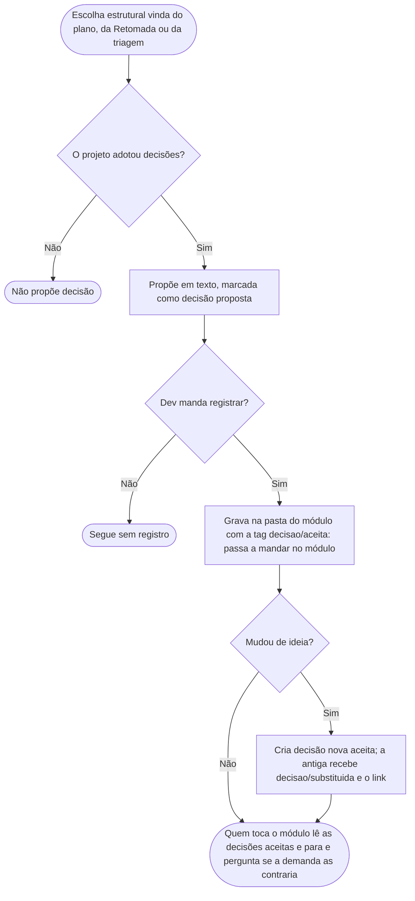

# Decisões de arquitetura

A decisão é o registro de uma escolha estrutural e do porquê dela. Serve para o time (daqui a meses) e para a IA não reabrirem uma discussão já resolvida nem sugerirem uma alternativa que já foi descartada. O padrão por trás é o **ADR** (*Architecture Decision Record*), descrito por Michael Nygard em 2011. A versão que o Claude lê é [../instrucoes/DECISOES.md](../instrucoes/DECISOES.md), telegráfica de propósito.

É opcional. Para adotar, basta aceitar a pergunta do `configurar-projeto`, que cria a área de decisões (só o índice). O molde da decisão é do plugin e não é copiado para `docs/padroes/`, que guarda só o que é exclusivo do projeto. Projeto que não adotou nunca recebe sugestão de decisão.

## O que vira decisão
Escolha estrutural difícil de reverter: tecnologia, framework, fronteira entre módulos, uma proibição. Escolha que vale só para uma tarefa fica no arquivo da própria tarefa (`**Decisão:**`); regra de negócio fica na especificação; um desvio pontual aceito vai para as [exceções aceitas](EXCECOES-ACEITAS.md).

## Como nasce
Nunca sem o aceite do Dev, e já com a tag `decisao/aceita`:
- No plano, a decisão vem marcada `decisão proposta`, e o Dev diz se cada uma deve ser registrada. Se sim, ela é gravada junto com as tarefas. Recusar a escolha ajusta o plano; recusar só o registro deixa a escolha apenas na seção Decisões do plano.
- Ao concluir uma tarefa com `Retomada`, a decisão é um dos destinos possíveis das escolhas que valem além da tarefa.
- Na triagem dos [pontos em aberto](PONTOS-EM-ABERTO.md), um achado aceito e estrutural também vira decisão.

## O que tem nela
Três campos, para a IA ler rápido: **Decisão e porquê**, **Descartado** (com o motivo) e **Não fazer**. O estado vai na tag: `aceita` ou `substituida`. Fica na pasta da unidade (módulo) a que pertence; decisão que vale para o projeto todo tem unidade própria. O nome do arquivo segue o padrão do projeto (sem padrão, a skill pergunta, sugerindo `<assunto>.md`), e cada decisão ganha uma linha no índice do módulo.

## Como é usada
Quem toca um módulo lê as decisões aceitas dele. A decisão aceita manda: se a demanda a contraria, a IA para e pergunta. Ela nunca bloqueia tarefa nem entra em Dependências.

## Mudou de ideia?
A decisão não é editada. Cria-se uma nova e a antiga ganha só a tag `substituida` e um link para a nova. O histórico fica inteiro.

## Fluxograma
Ciclo de vida de uma decisão, da proposta à substituição.

## Por que é assim
- **Segue o ADR de Nygard.** O texto original (2011) tem título, contexto, decisão, status e consequências, em uma ou duas páginas. Quando uma decisão é revertida, mantém-se a antiga, marcada como substituída com referência à nova; o plugin adota esse encadeamento. A regra de nunca editar o texto da antiga é do plugin. Os três campos (**Decisão e porquê**, **Descartado**, **Não fazer**) são uma adaptação, pensada para a IA: guardam o que mais evita reabrir discussões e sugerir de novo uma alternativa recusada.
- **Gravada já aceita.** O ADR de Nygard prevê o status proposto para quando os interessados ainda não concordaram. Aqui, essa concordância acontece no chat, quando o plano mostra a decisão proposta; por isso a decisão só é gravada depois do aceite e já nasce aceita, pronta para ser lida.
- **Só escolha difícil de reverter.** O ADR existe para decisões que custam caro de desfazer. Para o que é pequeno, existem o `**Decisão:**` da tarefa e as exceções aceitas, que são mais leves.
- **Nome em português, padrão conhecido.** O assunto se chama "decisão" e a tag é `decisao` (sem acento, como toda tag), porque o nome da tag segue o do assunto (ver [TAGS.md](TAGS.md)); ADR continua sendo o nome do padrão para quem quiser pesquisar mais.
