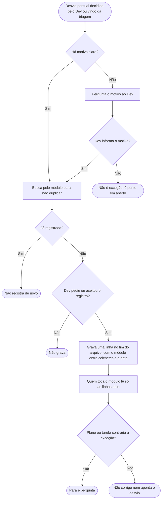

# Exceções aceitas

Num projeto grande, haverá lugares onde o padrão não se aplica de propósito: uma classe que não pode ser usada por compatibilidade, um caso que pede outra abordagem. Essas particularidades não são problema, são decisões pequenas, e não merecem uma decisão de arquitetura completa. O arquivo de exceções aceitas é o registro fixo delas, cada uma com o motivo. A versão que o Claude lê é [../instrucoes/EXCECOES-ACEITAS.md](../instrucoes/EXCECOES-ACEITAS.md), telegráfica de propósito.

É opcional. Adota-se aceitando a linha que o `configurar-projeto` oferece para o `CLAUDE.md` do projeto, que cobre este arquivo e o de [pontos em aberto](PONTOS-EM-ABERTO.md).

## O que entra
Um desvio pontual que o time decidiu manter, normalmente vindo da triagem dos pontos em aberto. Escolha estrutural difícil de reverter vai para uma [decisão](DECISOES.md). Desvio que será corrigido vira tarefa.

## Como é escrito
Uma linha por exceção: a regra que não vale ali, onde, o motivo, a área e a data. A área vai escrita na linha, entre colchetes (`[modulo/pedidos]`), para o Claude achar só as exceções do módulo em que está mexendo.

## Quem lê
Diferente dos pontos em aberto, aqui o Claude lê sozinho, mas só as linhas do módulo que ele vai tocar. Isso é necessário: sem ler, ele poderia "corrigir" uma exceção legítima ao editar o código, ou apontá-la na revisão. Exceção aceita manda; se o plano ou a tarefa a contraria, ele para e pergunta.

## Só entra com motivo
Sem motivo não é exceção, é ponto em aberto. Se o motivo mudar ou a exceção acabar, o texto é corrigido ou a linha é apagada.

## Fluxograma
Da exceção proposta ao uso do registro.

## Por que é assim
- **Exceção explícita, nunca silenciosa.** É o mesmo princípio de suprimir um aviso do linter com um comentário que explica o motivo: o desvio é aceito, mas fica registrado ao lado da razão, e quem chega depois sabe que foi de propósito.
- **Um registro à parte das regras.** Num projeto grande as exceções são muitas. Dentro dos arquivos de regras, que são lidos em toda revisão, elas os encheriam de casos particulares. Centralizadas, são lidas só por módulo.
- **Separada da decisão de arquitetura.** A decisão (ADR) é pesada de propósito: guarda alternativas descartadas e nunca é editada. Usá-la para particularidades pequenas a transformaria em depósito. Ver [DECISOES.md](DECISOES.md).
