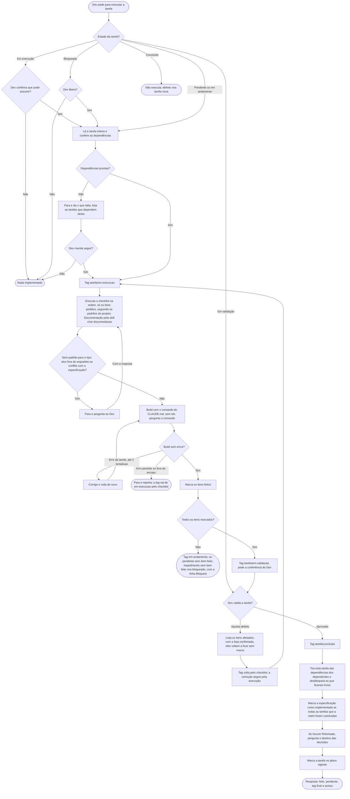

# Executar tarefa

A skill `executar-tarefa` executa uma tarefa sem pular a checagem de estado e de dependências, e só a dá por concluída com o "aprovado" do Dev. A versão que o Claude lê é [../../skills/executar-tarefa/SKILL.md](../../skills/executar-tarefa/SKILL.md), telegráfica de propósito. As duas dizem a mesma coisa.

- **Estado antes de tudo:** tarefa `em-execucao` (outra sessão pode estar nela, ou uma que caiu) → pergunta antes de assumir; `bloqueado` → para e diz o motivo (se o Dev liberar, a linha `**Bloqueio:**` sai); `em-validacao` → espera o "aprovado" ou o defeito; `concluido` → não executa (defeito vira tarefa nova, com a original em `**Ref:**`).
- **Dependência pendente:** para e avisa o que falta; o Dev decide se segue.
- **Especificação:** se a tarefa cita uma, ela precisa estar aprovada, senão o tratamento é o de dependência pendente. O critério da especificação manda; se a tarefa discorda dela, para e pergunta. Na conclusão, quando todas as tarefas que a citam estão concluídas, a especificação vira `implementada`.
- **Cadeia:** quando a execução para por dependência, lista as tarefas que dependem desta; só muda a tag do que o Dev aprovar.
- **Em execução:** a tarefa vira `em-execucao` ao começar e sai disso sempre que o trabalho para: todos os itens feitos → `em-validacao`; parte feita → `em-andamento`; nada feito → `pendente` (ou `bloqueado`, se parou por impedimento, com a linha `**Bloqueio:**` dizendo o que destrava). Tarefa com item feito nunca volta a `pendente` nem a `bloqueado`.
- **Validação:** com todos os itens feitos, a tarefa fica `em-validacao` e a resposta pede ao Dev que confira (a `revisar-qualidade` é opcional) e responda "aprovado" ou aponte o defeito. No defeito, ela lista os itens afetados (código, testes, documentação) e, com a lista confirmada, eles voltam a `[ ]`.
- **Conclusão (só no "aprovado"):** tira a tarefa das Dependências das que dependiam dela (apaga a linha se esvaziar) e libera as que ficaram sem nenhuma; as que têm a linha `**Bloqueio:**` só o Dev libera. Depois marca a especificação, trata a `Retomada` e marca o plano.
- **Plano:** se a tarefa consta no arquivo do plano vigente, na conclusão ela marca `[x]` na tarefa e, quando todas as tarefas de uma funcionalidade estão concluídas, na funcionalidade. Se a execução deixar algo sem resposta ou fora das tarefas, propõe uma pendência ao Dev e só grava com o aceite.
- **Por partes:** "faz a seção 1 da tarefa 02" executa só ela e, ao terminar, a tarefa fica `em-andamento` (ou `em-validacao`, se a seção fechar o checklist). Documentação fica `[ ]` até o Dev pedir. Com a tarefa toda, a Documentação é feita pela skill `criar-documentacao`, que escreve todos os docs do bloco de uma vez; os itens são marcados depois do build, com os demais.
- **Sub-itens:** "item b" executa o item e todos os sub-itens; "1.b.2" ou "item b.2" executa só aquele, lendo o item pai para saber a pasta. O item pai só é marcado quando todos os sub-itens estão marcados.
- **Padrão do projeto:** segue os padrões do projeto em `docs/padroes/` (práticas, convenções e modelos de tipo) e os princípios de qualidade do plugin (KISS, YAGNI, DRY, SRP). Em pasta ou arquivo novo, confere se a estrutura é igual à das outras unidades e se existe o espelho em docs, tarefas e testes.
- **Retomada:** se a tarefa tem a seção `Retomada` (gravada pelo `gerir-contexto` ao trocar de sessão), ela é lida primeiro: decisões e descartes valem, dúvida em aberto vira pergunta ao Dev. Na conclusão, ela pergunta o destino de cada decisão que vale além da tarefa (linha `**Decisão:**`, especificação, decisão do projeto ou outro destino) e só então apaga a seção.
- **Build:** sempre compila antes de fechar (comando do `CLAUDE.md`; sem ele, ela pergunta qual é). Erro causado pela tarefa: corrige e roda de novo, até 2 vezes; se persistir, para e reporta. Erro em código que a tarefa não toca: para e reporta, sem corrigir. Os itens só são marcados depois do build sem erro; build falho não marca nada e não conta como impedimento.

## Fluxograma
Comportamento da skill, do pedido à resposta final.

## Por que é assim
- **Dependências conferidas antes de começar.** É parecido com a definição de pronto para começar (*Definition of Ready*) usada por times ágeis: não se inicia o que ainda depende de algo que não existe.
- **Build antes de fechar.** É a regra da integração contínua: não se dá por pronto o que quebra a compilação.
- **Erro fora do escopo não é corrigido.** Com várias frentes em paralelo, o erro pode ser o código pela metade de outra pessoa ou agente; corrigir seria mexer no trabalho de outro.
- **A especificação manda sobre a tarefa.** A tarefa é o como; a especificação é o que foi combinado. Se divergem, a skill para e pergunta em vez de escolher.
- **`em-execucao` só enquanto alguém trabalha.** Funciona como a coluna "fazendo" do quadro Kanban: mostra que a tarefa já foi pega. Com várias sessões ou agentes, um não entra na tarefa do outro; ao parar, a tag sai e a tarefa fica livre.
- **Motivo do bloqueio gravado na tarefa.** A sessão acaba e o chat se perde; a linha `**Bloqueio:**` deixa o motivo visível para quem pegar a tarefa depois.
- **Concluído só com o "aprovado".** É a ideia do teste de aceitação: itens marcados e build verde dizem que o trabalho terminou; quem diz que está certo é o Dev.
- **Tarefa concluída não reabre.** Reabrir exigiria desfazer o que a conclusão já liberou (dependentes, especificação, plano), e outra frente pode já ter começado em cima dela. A tarefa de correção é mais barata e deixa o histórico claro.
