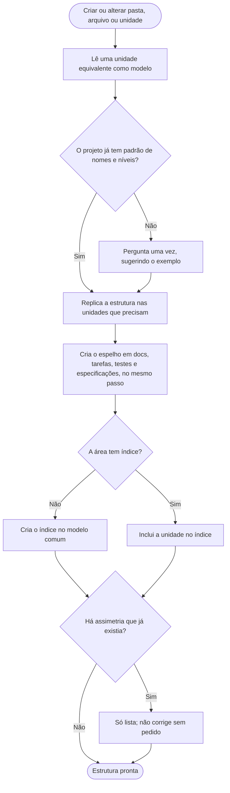

# Organização de pastas

O Claude lê [ORGANIZACAO.md](../instrucoes/ORGANIZACAO.md) sempre que vai criar ou alterar pasta, arquivo ou unidade. Aqui está o que isso significa para o Dev.

## A ideia
O plugin não escolhe nomes: ele impõe a **forma**. Todo projeto tem unidades (módulos, serviços, contextos) e cada unidade aparece com o mesmo nome no código, nos testes e em cada área de `docs/`. Os nomes, a quantidade de níveis e de áreas são do projeto; o Claude segue o que já existe e, sem padrão, pergunta uma vez.

## Como o projeto fica, por papel
```
<raiz>/
├── <memória do projeto>                 ex.: CLAUDE.md
├── <código>/<unidade>/<subpastas>
├── <testes>/<unidade>/<mesmas subpastas do código>
└── <docs>/
    ├── <área com unidades>/             índice da área · <unidade>/ (nota da unidade · subpastas)
    └── <área de padrões>/               índice da área · <grupo>/ (índice do grupo · itens)
```

## Regras que valem sempre
- **Mesmo nível, mesma estrutura.** Duas unidades irmãs têm as mesmas subpastas.
- **Subpasta só nasce com conteúdo.** Quando nasce, tem o mesmo nome e o mesmo lugar em toda unidade que precisar dela.
- **Espelho.** Unidade nova nasce de uma vez em todas as áreas, não só onde a mudança está sendo feita.
- **Artefato dentro da unidade.** Especificação, contrato ou cenário nunca fica solto.
- **Índice em toda área e todo grupo**, no mesmo modelo.
- **Assimetria que já existe** o Claude só lista; não corrige sem pedido do Dev.

## Área de padrões
É a área sem unidades: guarda o que o projeto adotou. Fica dividida em grupos por assunto (por exemplo, regras e modelos de tipo), cada um com o seu índice. A `configurar-projeto` oferece criar os arquivos vazios; o conteúdo é do projeto.

## Fluxograma
O que o Claude faz ao criar ou alterar pasta, arquivo ou unidade.



## Por que é assim
- **Unidade como contexto delimitado.** Tratar módulo, serviço ou contexto como unidade, com nome e fronteira próprios, é uma ideia inspirada no *bounded context* do DDD (Eric Evans, 2003). O plugin só impõe a forma; quais são as unidades é decisão do projeto.
- **Mesmo nível, mesma estrutura.** É a convenção sobre configuração (*convention over configuration*): se toda unidade é organizada igual, ninguém (nem a IA) precisa descobrir onde cada coisa fica.
- **Espelho entre código, testes e docs.** Espelhar a árvore do código na dos testes é uma convenção comum; aqui ela vale também para a documentação, as tarefas e as especificações, para achar o que é de uma unidade sem procurar.
- **Subpasta só nasce com conteúdo.** É o YAGNI: pasta vazia é estrutura sem uso.
