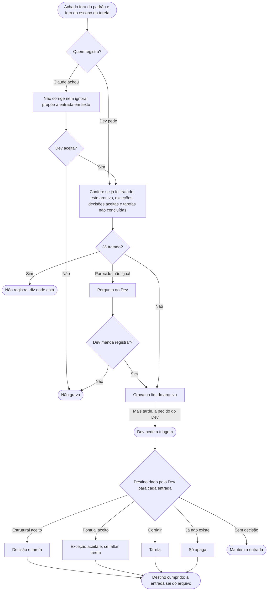

# Pontos em aberto

Às vezes, no meio de uma tarefa, o Dev (ou o Claude) encontra código fora do padrão do projeto, ou que talvez esteja fora, e que não dá para resolver agora. Sem um lugar para ele, o achado se perde ou vira correção fora do escopo da tarefa. O arquivo de pontos em aberto é esse lugar: uma peneira, onde tudo o que ainda não foi decidido entra e de onde sai quando ganha destino. A versão que o Claude lê é [../instrucoes/PONTOS-EM-ABERTO.md](../instrucoes/PONTOS-EM-ABERTO.md), telegráfica de propósito.

É opcional. Adota-se aceitando a linha que o `configurar-projeto` oferece para o `CLAUDE.md` do projeto. Ela cobre este arquivo e o de [exceções aceitas](EXCECOES-ACEITAS.md).

## Como registrar
- **O Dev pede:** "registra nos pontos em aberto". O Claude grava direto, no formato do arquivo.
- **O Claude acha:** ele não corrige nem ignora. Propõe em texto a entrada pronta e só grava se o Dev aceitar.

Antes de registrar, o Claude confere se o achado já foi tratado: no próprio arquivo, nas exceções aceitas, nas decisões aceitas do módulo e nas tarefas ainda não concluídas. Se já foi, ele diz onde está e não registra de novo. Assim o mesmo achado não volta a cada desenvolvedor que passa por ele.

O arquivo é um só, na raiz de `docs/` (sugestão `docs/pontos-em-aberto.md`), criado no primeiro registro. Cada entrada diz o que foge do padrão (ou a dúvida se foge) e qual regra do projeto isso quebra, onde está (sem número de linha, que envelhece), o impacto, a área e a data.

## Quem lê
Só o Dev, por padrão. O Claude não consulta o arquivo sozinho. Ele lê quando o Dev pede, por exemplo "o que tem em aberto em X?".

## Triagem
Quando o time for decidir, o pedido é "faz a triagem dos pontos em aberto". O Claude lista as entradas e, para cada uma, o Dev escolhe o destino:
- **Aceito, escolha estrutural:** vira [decisão](DECISOES.md) e gera uma tarefa com o que precisa ser feito, porque é uma mudança estrutural.
- **Aceito, pontual, ou "não era problema":** vai para as [exceções aceitas](EXCECOES-ACEITAS.md), com o motivo. Se a regra estava ambígua, o melhor é esclarecê-la. Se algo ainda não foi implementado e não existe tarefa, vira também uma tarefa.
- **Corrigir:** vira tarefa.
- **Já não existe:** a entrada é apagada.

Cumprido o destino, a entrada sai do arquivo, e o destino guarda a história.

## Fluxograma
Do achado ao destino na triagem.

## Por que é assim
- **Peneira separada do registro.** Triagem de achados é prática comum na manutenção de projetos (*issue triage*): o que chega é avaliado e ganha um destino, em vez de ficar acumulado. Misturar o que está em aberto com o que já foi aceito deixaria o arquivo sempre crescendo e sem utilidade.
- **Parente da gestão de dívida técnica.** Manter uma lista de desvios conhecidos, com impacto e decisão do time sobre cada um, é prática da gestão de dívida técnica. Aqui o arquivo é mais amplo: guarda também o que talvez nem seja problema.
- **Só o Dev lê por padrão.** Cada leitura do Claude custa tokens e, na maioria das tarefas, o arquivo não muda nada. O Claude só consulta quando vai registrar (para não duplicar) ou quando o Dev pede.
- **Um arquivo só.** É o mais barato e o mais fácil de levar para uma reunião.
