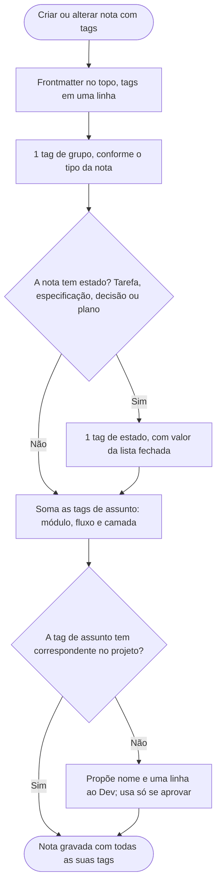

# Tags

As tags ajudam a achar arquivos de documentação e tarefas sem abrir um por um. A versão que o Claude lê é [../instrucoes/TAGS.md](../instrucoes/TAGS.md), telegráfica de propósito. As duas dizem a mesma coisa.

## A ideia
Cada nota (doc, especificação, tarefa, plano, decisão…) leva uma linha de tags no topo, por exemplo `tags: [tarefas, modulo/entregas, fluxo/checkout, tarefa/pendente]`. Para achar tudo de um assunto, o Claude busca essa linha (Grep, uma busca por texto dentro dos arquivos) em vez de ler pasta por pasta.

A ligação entre doc e tarefa é só pela tag em comum. A documentação nunca cita tarefas, e nada quebra quando um arquivo muda de nome ou de lugar.

**As tags não dependem das pastas.** Toda nota leva todas as tags dela, mesmo quando a pasta "já diria" o mesmo. Se um dia tudo for reunido numa pasta só, as buscas por tag continuam funcionando.

## Estrutura simétrica
As áreas com módulos têm a mesma forma:

```
docs/
├── tarefas/
│   ├── tarefas.md                  visão geral
│   └── modulos/<m>/
│       ├── <m>.md                  nota do módulo
│       └── NN-<nome>.md            tarefa
├── documentacao/
│   ├── documentacao.md             visão geral
│   └── modulos/<m>/
│       ├── <m>.md                  nota do módulo
│       ├── api/
│       └── fluxos/
├── especificacoes/
│   ├── especificacoes.md           visão geral
│   └── modulos/<m>/
│       ├── <m>.md                  regras de negócio do módulo
│       └── fluxos/
└── planos/
    ├── planos.md                   visão geral
    └── modulos/<m>/
        ├── <m>.md                  nota do módulo
        └── <demanda>.md            plano
```

Fluxos que tocam mais de um módulo ficam na pasta do módulo principal (o primeiro citado), e as notas dos outros módulos linkam para eles.

## Grupo
Toda nota leva uma tag de grupo: `tarefas`, `plano`, `documentacao`, `especificacao`, `decisao`, `ponto-em-aberto`, `excecao-aceita` ou `padrao` (nomes de exemplo: se o projeto já usa outros, valem os dele). O nome do grupo é o do assunto, o mesmo do arquivo e da instrução: sem sigla nem sinônimo. As skills gravam sozinhas. Ela serve para filtrar o grafo do Obsidian (`tag:#tarefas` ou `tag:#documentacao`; cada uma pode virar favorito). Cor e filtros do grafo ficam a cargo do Dev: o plugin não mexe no `graph.json`.

## Estado: tarefa, especificação, decisão e plano
A tarefa leva `tarefa/<estado>`, a especificação `especificacao/<estado>`, a decisão `decisao/<estado>` e o plano `plano/<estado>`. Uma tag só diz **o que a nota é** e **em que pé está**. No Obsidian, `tag:#tarefa` lista todas as tarefas e `-tag:#tarefa/concluido` esconde as concluídas.
- Tarefa: `pendente` (nada feito e nada a prende), `em-andamento` (parte feita, ninguém trabalhando nela), `em-execucao` (alguém trabalhando nela agora), `em-validacao` (tudo feito, aguardando o "aprovado" do Dev), `concluido` (aprovada pelo Dev; não reabre) e `bloqueado` (nada feito e preso por dependência, especificação ou impedimento; o impedimento fica na linha `**Bloqueio:**` e só o Dev libera). Não há estado de cancelada: a tarefa que não será feita só é apagada em caso extremo, com aceite do Dev, levando junto a linha do índice, os links em Dependências e a linha no plano.
- Especificação: `rascunho`, `aprovada`, `implementada`, `obsoleta`.
- Decisão: `aceita` (já ao ser gravada, com o aceite do Dev) e `substituida`.
- Plano: `vigente` e `obsoleto`.

Especificação e plano que alguma nota cita não são apagados: viram obsoletos, com motivo, data e, se houver, link para o substituto.

O Claude troca só essa tag quando o andamento muda, sem mexer nas outras. Quem troca são as skills que mexem na nota (`criar-tarefa`, `executar-tarefa`, `criar-documentacao`, `criar-especificacao` e `criar-plano`). Notas gerais, do módulo e docs não levam estado, para não ficarem desatualizadas.

## Tags de assunto
Três eixos, iguais para tarefa e doc:
- `modulo/`: o módulo.
- `camada/`: a camada (`api`, e depois `dominio`, `aplicacao`... quando essas camadas forem documentadas).
- `fluxo/`: o comportamento ou fluxo.

Quais notas levam o quê:

| Nota | Tags |
|---|---|
| Geral | `[documentacao]` ou `[tarefas]` |
| Módulo | grupo + `modulo/autenticacao` |
| Tarefa | `[tarefas, modulo/autenticacao, fluxo/autenticacao-cadastro, tarefa/concluido]` |
| Plano | `[plano, modulo/autenticacao, fluxo/autenticacao-cadastro, plano/vigente]` |
| Decisão | `[decisao, modulo/autenticacao, decisao/aceita]` |
| Especificação de fluxo | `[especificacao, modulo/autenticacao, fluxo/autenticacao-cadastro, especificacao/aprovada]` |
| Doc de fluxo | `[documentacao, modulo/autenticacao, fluxo/autenticacao-cadastro]` |
| Doc de camada (ex. API) | `[documentacao, modulo/autenticacao, camada/api]` |
| Pontos em aberto (arquivo único) | `[ponto-em-aberto]` |
| Exceções aceitas (arquivo único) | `[excecao-aceita]` |
| Padrão (índice, regra ou modelo de tipo) | `[padrao]`; modelo de uma camada: `[padrao, camada/aplicacao]` |

A nota do módulo é a que não tem `camada/`, `fluxo/` nem estado. A tarefa herda `fluxo/` e `camada/` das docs do bloco Documentação: se ela não gera doc de domínio, não leva `camada/dominio`. Para documentar algo novo (comportamento, domínio, infra), basta usar um valor desses eixos, sem criar tag nova.

## Sem lista de tags
Não há arquivo com a lista. As tags de assunto só usam nomes que já existem: um módulo, camada ou fluxo já em uso ou documentado. Se o Claude precisar de uma tag sem correspondente (por exemplo, um fluxo ainda não documentado), ele **propõe e espera o Dev aprovar**. Assim o vocabulário não se espalha (`entrega`, `entregas`, `delivery`).

## Projeto que já tem docs e tarefas
Notas antigas fora do formato são ajustadas pelas migrações de cada versão (por exemplo, a da 0.17.0, em [../migracoes/0.17.0.md](../migracoes/0.17.0.md)), que listam o que muda e só aplicam com a aprovação do Dev.

## Exemplos de pedido
- "Quais tarefas estão pendentes?"
- "O que temos sobre o módulo entregas?"
- "Tarefas pendentes do fluxo checkout."
- "O que temos documentado da API?"

## Fluxograma
Como uma nota recebe as tags, e como os estados mudam.

```mermaid
flowchart TD
  subgraph T["Tarefa"]
    T1(["pendente, ao criar"]) -- "Execução começa" --> T5["em-execucao"]
    T1 -- "Dependência, especificação ou impedimento" --> T3["bloqueado"]
    T3 -- "Resolvido ou liberado pelo Dev" --> T1
    T5 -- "Parou com parte feita" --> T2["em-andamento"]
    T5 -- "Parou sem nada feito" --> T1
    T5 -- "Parou por impedimento, sem nada feito" --> T3
    T2 -- "Execução retoma" --> T5
    T5 -- "Todos os itens feitos" --> T6["em-validacao"]
    T6 -- "Dev aponta defeito; itens afetados voltam" --> T2
    T6 -- "Dev aprova" --> T4(["concluido"])
  end
  subgraph S["Especificação"]
    S1(["rascunho, ao criar ou alterar"]) -- "Dev aprova" --> S2["aprovada"]
    S2 -- "Regra muda" --> S1
    S2 -- "Todas as tarefas que a citam concluídas" --> S3(["implementada"])
    S3 -- "Regra muda" --> S1
    S3 -- "Tarefa nova a cita" --> S2
    S1 -- "Dev diz que ficou obsoleta" --> S4(["obsoleta"])
    S2 -- "Dev diz que ficou obsoleta" --> S4
    S3 -- "Dev diz que ficou obsoleta" --> S4
  end
  subgraph D["Decisão"]
    D1(["aceita, ao ser gravada com o aceite do Dev"]) -- "Decisão nova aceita a substitui" --> D3(["substituida"])
  end
  subgraph P["Plano"]
    P1(["vigente, ao ser gravado"]) -- "Dev diz que ficou obsoleto" --> P2(["obsoleto"])
  end
```





## Por que é assim
- **Tags em frontmatter YAML.** É o formato que o Obsidian (propriedades) e vários geradores de site já leem, então a mesma linha serve ao Claude e a essas ferramentas.
- **Tags numa linha só.** O Claude acha as notas por uma busca de texto (Grep) sem abrir cada arquivo, o que é muito mais barato que ler pasta por pasta.
- **Estados com valores fechados.** Um conjunto fixo evita variações como `pendente`, `em aberto` e `a fazer` para a mesma coisa.
- **`em-execucao` separado de `em-andamento`.** Um diz que alguém trabalha na tarefa agora; o outro, só que parte já foi feita. Com várias sessões ou agentes em paralelo, isso evita que um pegue a tarefa do outro, como a coluna "fazendo" do quadro Kanban.
- **Obsoleto em vez de apagado.** Quem lê depois entende por que algo mudou, e os links das outras notas continuam valendo. Sem nenhuma nota citando, apagar não perde nada: o git guarda o arquivo.
- **O nome da tag é o do assunto.** É a ideia de linguagem onipresente do DDD (Eric Evans, 2003), aplicada aos nomes do plugin: o mesmo nome no arquivo, na instrução, na tag e na conversa, sem sigla nem sinônimo.
